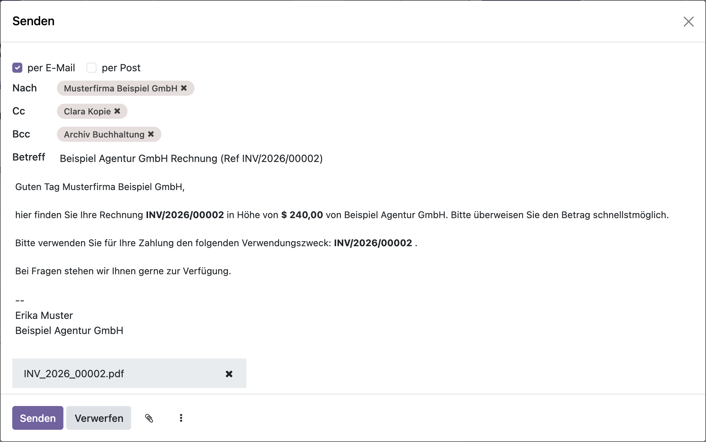
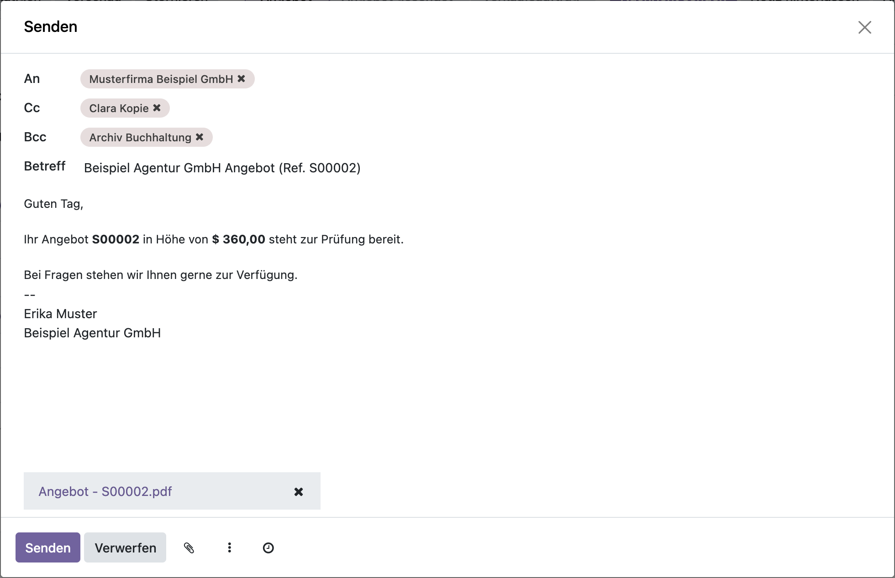

# Cc und Bcc für Odoo
<!-- /!\ Non OCA Context : Set here the badge of your runbot / runboat instance. -->
[](https://github.com/BM1-de/odoo-mail-cc-bcc/actions/workflows/pre-commit.yml?query=branch%3A19.0)
[](https://github.com/BM1-de/odoo-mail-cc-bcc/actions/workflows/test.yml?query=branch%3A19.0)
[](https://codecov.io/gh/BM1-de/odoo-mail-cc-bcc)
<!-- /!\ Non OCA Context : Set here the badge of your translation instance. -->

<!-- /!\ do not modify above this line -->

Die Felder *Cc* und *Bcc* beim Mailversand aus Odoo – im Mail-Dialog für Angebote, Aufträge
und Nachrichten und im Senden-Dialog der Rechnung. Alle Empfänger bekommen **eine einzige
E-Mail** mit An und Cc im Kopf, statt je Empfänger eine eigene:

```text
An:   rechnung@musterfirma.example.com
Cc:   anna.beispiel@musterfirma.example.com
Bcc:  archiv@agentur.example.com        (sieht niemand)
```

> **Alpha:** Die Module sind neu. Die Software wird ohne Gewährleistung bereitgestellt
> (AGPL-3.0, Abschnitte 15 und 16).



## Die Module

| Modul | Zweck |
| ----- | ----- |
| [mail_send_cc_bcc](mail_send_cc_bcc/README.rst) | Cc und Bcc im Mail-Dialog, Versand als eine E-Mail an alle Empfänger |
| [account_move_send_cc_bcc](account_move_send_cc_bcc/README.rst) | Cc und Bcc im Senden-Dialog der Rechnung; wird mit der Rechnungsstellung automatisch installiert |

## Was die Module tun

- Odoo 19 kennt beim Versand an Kunden weder Cc noch Bcc und verschickt je Empfänger eine
  eigene E-Mail: Eine Rechnung an zwei Personen verlässt den Server als zwei E-Mails. Mit
  den Modulen ist es eine.
- Wer eine Blindkopie bekommt, sieht niemand: weder die anderen Empfänger noch Portalbenutzer,
  die die Nachrichten ihres Belegs lesen.
- Zwei oder mehr Kunden in *An* bekommen ebenfalls eine gemeinsame E-Mail.
- Follower des Belegs und interne Benutzer in *An* behalten die Benachrichtigung von Odoo
  mit den Schaltflächen ihrer Gruppe.
- Odoo 20 bringt Cc im Mail-Dialog selbst mit. Die Module benutzen dieselben Feldnamen; nach
  einem Upgrade bleiben die Cc-Empfänger alter Nachrichten erhalten. Unter Odoo 20 ergänzen
  sie Bcc, Cc und Bcc im Rechnungsversand und den Versand als eine E-Mail.



## Einrichtung

Nichts einzurichten: installieren, dann stehen *Cc* und *Bcc* unter *An*.

## Grenzen

- Cc und Bcc gibt es für die Nachricht an einem Beleg, nicht beim Versand an mehrere Belege
  auf einmal (Massenversand, Sammelversand von Rechnungen).
- Das kleine Nachrichtenfeld im Chatter hat kein Cc und Bcc; dafür den vollständigen
  Mail-Dialog öffnen.
- Eine E-Mail hat einen Zustand: Ist sie versandt, gelten alle Empfänger als benachrichtigt.

## Mehr Dokumentation

Die Beschreibungen der Module (englisch) stehen in
[mail_send_cc_bcc/README.rst](mail_send_cc_bcc/README.rst) und
[account_move_send_cc_bcc/README.rst](account_move_send_cc_bcc/README.rst).

*English: Cc and Bcc when sending emails from Odoo, in the email composer and in the invoice
sending dialog, sent as one single email to all recipients. Alpha, no warranty.*

<!-- /!\ do not modify below this line -->

<!-- prettier-ignore-start -->

[//]: # (addons)

Available addons
----------------
addon | version | maintainers | summary
--- | --- | --- | ---
[account_move_send_cc_bcc](account_move_send_cc_bcc/) | 19.0.1.0.0 | <a href='https://github.com/bm1-phillip'></a> | Cc and Bcc recipients when sending an invoice by email, sent as one single email to all recipients
[mail_send_cc_bcc](mail_send_cc_bcc/) | 19.0.1.0.0 | <a href='https://github.com/bm1-phillip'></a> | Cc and Bcc recipients in the email composer, sent as one single email to all recipients instead of one email per recipient

[//]: # (end addons)

<!-- prettier-ignore-end -->

## Licenses

This repository is licensed under [AGPL-3.0](LICENSE).

However, each module can have a totally different license, as long as they adhere to Baumgärtner Marketing GmbH
policy. Consult each module's `__manifest__.py` file, which contains a `license` key
that explains its license.

----
<!-- /!\ Non OCA Context : Set here the full description of your organization. -->

<!-- bm1-verweise:start (scripts/readme-bm1.py, nicht von Hand ändern) -->

## Weitere Odoo-Projekte von BM1

| Projekt | Zweck |
| ------- | ----- |
| [Briefanrede](https://github.com/BM1-de/odoo-partner-salutation) | Anrede am Kontakt und die passende Grußzeile in Rechnungsmails |
| [Namenszusatz](https://github.com/BM1-de/odoo-partner-name-addition) | Zweite Namenszeile am Kontakt, gedruckt in jeder Anschrift |
| [Stundennachweis auf der Rechnung](https://github.com/BM1-de/odoo-timesheet-invoice) | Abgerechnete Zeiteinträge auf der Rechnung, je Aufgabe summiert |
| [Arbeitszeitgesetz](https://github.com/BM1-de/odoo-l10n-germany-arbzg) | Gesetzliche Pausen und Höchstarbeitszeit bei Anwesenheiten, Arbeitszeitkonto ab Odoo 20 |
| [Deutsche EÜR](https://github.com/BM1-de/odoo-l10n-germany-euer) | Einnahmenüberschussrechnung mit Anlage EÜR, AVEÜR und Anlagenverzeichnis |
| [Papierkram-Import](https://github.com/BM1-de/odoo-papierkram-import) | Kontakte, Rechnungen, Belege, Zahlungen und Zeiten aus Papierkram übernehmen |
| [Zeiterfassung für Odoo (macOS)](https://github.com/BM1-de/timesheets-for-odoo) | Menüleisten-App für Zeiten und Anwesenheit |
| [Zeiterfassung für Odoo (Windows)](https://github.com/BM1-de/timesheets-for-odoo-windows) | App im Infobereich für Zeiten und Anwesenheit |

## Über BM1

<a href="https://bm1.de"><picture><source media="(prefers-color-scheme: dark)" srcset="docs/bm1/logo-bm1-negativ.svg"></picture></a>

Entwickelt und gepflegt von [BM1](https://bm1.de), der Baumgärtner Marketing GmbH aus
Bayreuth: Agentur für [Websites](https://bm1.de/websites/),
[Webentwicklung](https://bm1.de/webentwicklung/), [SEO](https://bm1.de/seo/) und
[individuelle digitale Lösungen](https://bm1.de/digitale-spezial-themen/). Wir arbeiten selbst
jeden Tag mit Odoo und bauen, was uns dort fehlt. Wenn Sie Unterstützung bei Odoo, einer
Website oder einer Anbindung brauchen, die es nicht von der Stange gibt:
[sprechen Sie uns an](https://bm1.de/kontakt/).

<!-- bm1-verweise:end -->
