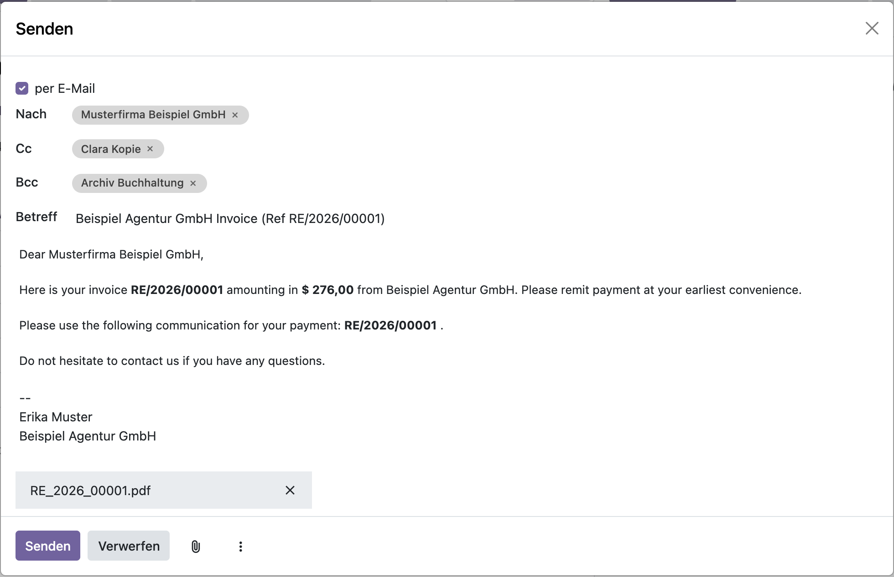

========================
Invoice Email Cc and Bcc
========================

.. 
   !!!!!!!!!!!!!!!!!!!!!!!!!!!!!!!!!!!!!!!!!!!!!!!!!!!!
   !! This file is generated by oca-gen-addon-readme !!
   !! changes will be overwritten.                   !!
   !!!!!!!!!!!!!!!!!!!!!!!!!!!!!!!!!!!!!!!!!!!!!!!!!!!!
   !! source digest: sha256:979bf6bfcb53cf7a861e9ea5c7d72417aee335296a88a5cc71b6b7ce8c47a3b5
   !!!!!!!!!!!!!!!!!!!!!!!!!!!!!!!!!!!!!!!!!!!!!!!!!!!!

.. |badge1| image:: https://img.shields.io/badge/maturity-Alpha-red.png
    :target: https://odoo-community.org/page/development-status
    :alt: Alpha
.. |badge2| image:: https://img.shields.io/badge/license-AGPL--3-blue.png
    :target: http://www.gnu.org/licenses/agpl-3.0-standalone.html
    :alt: License: AGPL-3
.. |badge3| image:: https://img.shields.io/badge/github-BM1--de%2Fodoo--mail--cc--bcc-lightgray.png?logo=github
    :target: https://github.com/BM1-de/odoo-mail-cc-bcc/tree/20.0/account_move_send_cc_bcc
    :alt: BM1-de/odoo-mail-cc-bcc

|badge1| |badge2| |badge3|

Adds the fields *Cc* and *Bcc* to the dialog that sends an invoice or a
credit note by email. The customer, the Cc recipients and the Bcc
recipients get **one single email** with the invoice attached, instead
of one email per recipient as Odoo sends them.

Nobody sees who got a blind copy. In the chatter of the invoice the
message lists all recipients for internal users.

The sending itself is done by the module *Email Cc and Bcc in One Email*
(``mail_send_cc_bcc``), which adds the same fields to the email composer
used for quotations, orders and messages. This module is installed
automatically when both it and Invoicing are installed.

.. IMPORTANT::
   This is an alpha version, the data model and design can change at any time without warning.
   Only for development or testing purpose, do not use in production.
   `More details on development status <https://odoo-community.org/page/development-status>`_

**Table of contents**

.. contents::
   :local:

Usage
=====

- Open a posted invoice and click *Send*.
- Enter the recipients in *To*, *Cc* and *Bcc* and send. One email
  leaves Odoo.

|The dialog that sends an invoice, with Cc and Bcc|

Other modules pass the copies to the sending like the recipients, as
lists of partner IDs in the settings ``mail_partner_cc_ids`` and
``mail_partner_bcc_ids``:

::

   self.env["account.move.send"]._generate_and_send_invoices(
       invoices,
       sending_methods=["email"],
       mail_partner_cc_ids=cc_partners.ids,
   )

Known issues / Roadmap
======================

- Sending several invoices at once has no dialog per invoice and
  therefore no Cc and Bcc.
- The Cc of the email template is added to *To* as Odoo does it in this
  dialog. The recipients still get one common email.

Changelog
=========

20.0.1.0.0 (2026-11-19)
-----------------------

- Version for Odoo 20.

19.0.1.0.0 (2026-11-19)
-----------------------

- First version.

Bug Tracker
===========

Bugs are tracked on `GitHub Issues <https://github.com/BM1-de/odoo-mail-cc-bcc/issues>`_.
In case of trouble, please check there if your issue has already been reported.
If you spotted it first, help us to smash it by providing a detailed and welcomed
`feedback <https://github.com/BM1-de/odoo-mail-cc-bcc/issues/new?body=module:%20account_move_send_cc_bcc%0Aversion:%2020.0%0A%0A**Steps%20to%20reproduce**%0A-%20...%0A%0A**Current%20behavior**%0A%0A**Expected%20behavior**>`_.

Do not contact contributors directly about support or help with technical issues.

Credits
=======

Authors
-------

* Baumgärtner Marketing GmbH

Contributors
------------

- Phillip Baumgärtner baumgaertner@bm1.de

Maintainers
-----------

.. |maintainer-bm1-phillip| image:: https://github.com/bm1-phillip.png?size=40px
    :target: https://github.com/bm1-phillip
    :alt: bm1-phillip

Current maintainer:

|maintainer-bm1-phillip| 

This module is part of the `BM1-de/odoo-mail-cc-bcc <https://github.com/BM1-de/odoo-mail-cc-bcc/tree/20.0/account_move_send_cc_bcc>`_ project on GitHub.

You are welcome to contribute.
