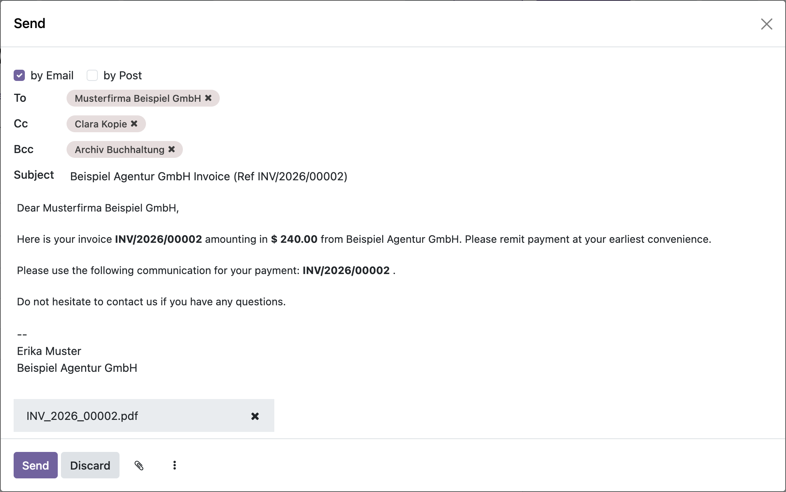

- Open a posted invoice and click *Send*.
- Enter the recipients in *To*, *Cc* and *Bcc* and send. One email leaves
  Odoo.

Other modules pass the copies to the sending like the recipients, as lists of
partner IDs in the settings `mail_partner_cc_ids` and `mail_partner_bcc_ids`:

    self.env["account.move.send"]._generate_and_send_invoices(
        invoices,
        sending_methods=["email"],
        mail_partner_cc_ids=cc_partners.ids,
    )
