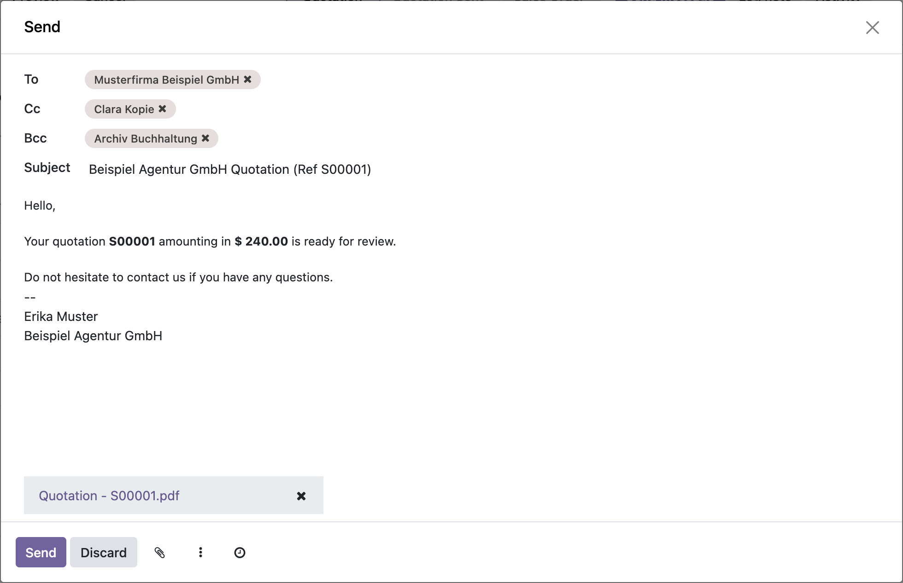

=============================
Email Cc and Bcc in One Email
=============================

.. 
   !!!!!!!!!!!!!!!!!!!!!!!!!!!!!!!!!!!!!!!!!!!!!!!!!!!!
   !! This file is generated by oca-gen-addon-readme !!
   !! changes will be overwritten.                   !!
   !!!!!!!!!!!!!!!!!!!!!!!!!!!!!!!!!!!!!!!!!!!!!!!!!!!!
   !! source digest: sha256:49b0219952df7fe6712463cbdafe26ffa012a8b1b976f0f3cf73aaa3d3b9feff
   !!!!!!!!!!!!!!!!!!!!!!!!!!!!!!!!!!!!!!!!!!!!!!!!!!!!

.. |badge1| image:: https://img.shields.io/badge/maturity-Alpha-red.png
    :target: https://odoo-community.org/page/development-status
    :alt: Alpha
.. |badge2| image:: https://img.shields.io/badge/license-AGPL--3-blue.png
    :target: http://www.gnu.org/licenses/agpl-3.0-standalone.html
    :alt: License: AGPL-3
.. |badge3| image:: https://img.shields.io/badge/github-BM1--de%2Fodoo--mail--cc--bcc-lightgray.png?logo=github
    :target: https://github.com/BM1-de/odoo-mail-cc-bcc/tree/19.0/mail_send_cc_bcc
    :alt: BM1-de/odoo-mail-cc-bcc

|badge1| |badge2| |badge3|

Adds the fields *Cc* and *Bcc* to the email composer and sends a message
as **one single email** to all its recipients.

Out of the box Odoo 19 has no Cc or Bcc when you send a quotation, an
order or any other message to a customer, and it sends one email per
recipient: a message to two people leaves the server as two emails, each
addressed to one of them. With this module

- the composer has a line *Cc* and a line *Bcc* below *To*,
- the recipients in To, Cc and Bcc get the same single email, with the
  To and Cc recipients in its header, as any mail program would send it,
- nobody sees who got a blind copy: not the other recipients, and not
  portal users who look at the messages of their document,
- two or more customers in *To* also get one common email instead of one
  each.

Sending invoices has its own dialog in Odoo; the module *Invoice Email
Cc and Bcc* (``account_move_send_cc_bcc``), installed automatically with
Invoicing, adds both lines there.

Followers of the document and internal users in *To* keep the
notification of Odoo with the buttons of their group; nothing changes
for them.

The fields use the names of Odoo 20, which brings Cc in its composer:
after an upgrade the Cc recipients of old messages are kept.

.. IMPORTANT::
   This is an alpha version, the data model and design can change at any time without warning.
   Only for development or testing purpose, do not use in production.
   `More details on development status <https://odoo-community.org/page/development-status>`_

**Table of contents**

.. contents::
   :local:

Configuration
=============

Nothing to configure.

Who gets the one common email:

- every partner in Cc and Bcc, also internal users, and also users who
  read their notifications in Odoo instead of by email: a copy is a copy
  of the email. Who enters himself gets it, too;
- customers and other external partners in To.

A message without Cc and Bcc is only sent as one email if it is a
message to customers (not a notification of Odoo), has at least two
external partners in To and fewer than 50 of them. From that number on
Odoo does not show the recipients of a message to each other, and
neither does this module.

The common email has the language and the layout of its first external
recipient in To. It never carries the buttons Odoo shows to internal
users.

Usage
=====

- Open the full composer on a document, for example with *Send by Email*
  on a quotation or with *Send message* and the button *Open Full
  Composer* in the chatter.
- Enter the recipients in *To*, *Cc* and *Bcc* and send. One email
  leaves Odoo.

|The email composer with Cc and Bcc|

- The message in the chatter lists every recipient with the state of the
  email; open it with the envelope next to the message.
- A reply to a message proposes its Cc recipients again. Blind copies
  are never proposed again.

Other modules pass the copies to ``message_post()`` like the recipients:

::

   record.message_post(
       body=body,
       message_type="comment",
       subtype_xmlid="mail.mt_comment",
       partner_ids=to_partners.ids,
       partner_cc_ids=cc_partners.ids,
       partner_bcc_ids=bcc_partners.ids,
   )

Known issues / Roadmap
======================

- Cc and Bcc belong to a message on one document. Sending to several
  documents at once (mass mailing mode of the composer) does not offer
  them.
- The small message box of the chatter has no Cc and Bcc; open the full
  composer.
- The Cc of an email template is added to *To* as in Odoo 19 itself. The
  recipients still get one common email.
- One email has one state: if it is sent, every recipient counts as
  notified. A partner without an email address is left out and marked as
  failed.
- Followers get their own notification as before. Its header does not
  name the recipients of the common email anymore.
- A message scheduled for later is sent with its Cc and Bcc recipients;
  the form of the scheduled message does not show them.

Changelog
=========

19.0.1.0.0 (2026-11-19)
-----------------------

- First version.

Bug Tracker
===========

Bugs are tracked on `GitHub Issues <https://github.com/BM1-de/odoo-mail-cc-bcc/issues>`_.
In case of trouble, please check there if your issue has already been reported.
If you spotted it first, help us to smash it by providing a detailed and welcomed
`feedback <https://github.com/BM1-de/odoo-mail-cc-bcc/issues/new?body=module:%20mail_send_cc_bcc%0Aversion:%2019.0%0A%0A**Steps%20to%20reproduce**%0A-%20...%0A%0A**Current%20behavior**%0A%0A**Expected%20behavior**>`_.

Do not contact contributors directly about support or help with technical issues.

Credits
=======

Authors
-------

* Baumgärtner Marketing GmbH

Contributors
------------

- Phillip Baumgärtner baumgaertner@bm1.de

Maintainers
-----------

.. |maintainer-bm1-phillip| image:: https://github.com/bm1-phillip.png?size=40px
    :target: https://github.com/bm1-phillip
    :alt: bm1-phillip

Current maintainer:

|maintainer-bm1-phillip| 

This module is part of the `BM1-de/odoo-mail-cc-bcc <https://github.com/BM1-de/odoo-mail-cc-bcc/tree/19.0/mail_send_cc_bcc>`_ project on GitHub.

You are welcome to contribute.
