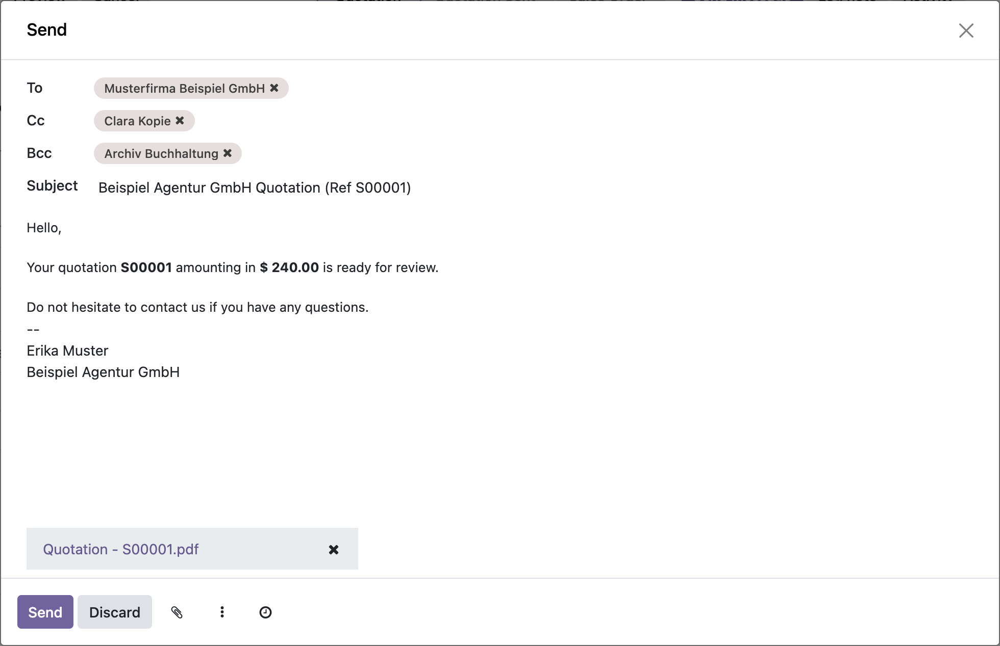

- Open the full composer on a document, for example with *Send by Email* on a
  quotation or with *Send message* and the button *Open Full Composer* in the
  chatter.
- Enter the recipients in *To*, *Cc* and *Bcc* and send. One email leaves
  Odoo.

- The message in the chatter lists every recipient with the state of the
  email; open it with the envelope next to the message.
- A reply to a message proposes its Cc recipients again. Blind copies are
  never proposed again.

Other modules pass the copies to `message_post()` like the recipients:

    record.message_post(
        body=body,
        message_type="comment",
        subtype_xmlid="mail.mt_comment",
        partner_ids=to_partners.ids,
        partner_cc_ids=cc_partners.ids,
        partner_bcc_ids=bcc_partners.ids,
    )
